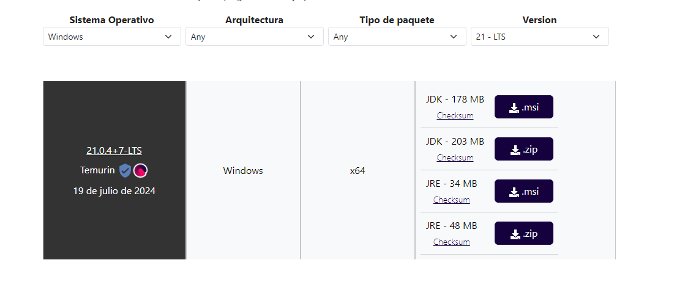
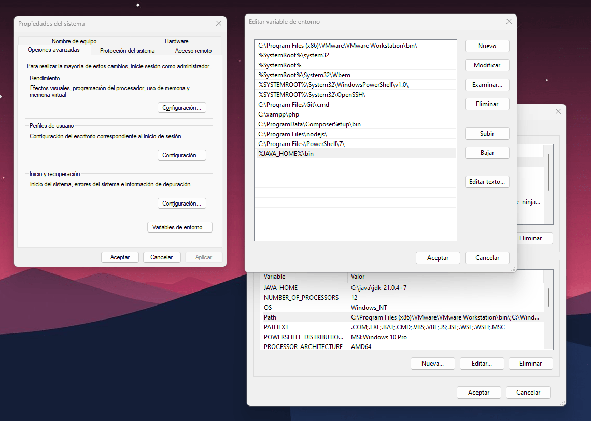

Si eres un desarrollador de Java o estás estudiando un ciclo de Desarrollo de Aplicaciones Web (DAW) o Multiplataforma (DAM) y te has preguntado: ¿Qué es el JDK? ¿Por qué instalamos el JDK de Oracle? ¿Hay más opciones? En este post vamos a ver cómo instalar el JDK de Java en Windows y las diferentes opciones que tenemos.

## ¿Qué es el JDK?

El **JDK (Java Development Kit)** es un conjunto de herramientas que nos permiten desarrollar aplicaciones en Java. Incluye el compilador de Java, las bibliotecas de clases de Java, la máquina virtual de Java (JVM) y otras herramientas necesarias para desarrollar aplicaciones en Java.

## Guía para instalar un JDK: opciones y recomendaciones

Cuando desarrollas en Java, uno de los primeros pasos es instalar el Java Development Kit (JDK). Existen varias distribuciones del JDK, y cada una tiene características particulares, lo que puede hacer que elegir una versión sea todo un desafío.

A continuación, te presento las opciones más populares y sus principales diferencias.

- ⛔**Oracle JDK**: Es la versión oficial proporcionada por Oracle. Ofrece soporte comercial y actualizaciones frecuentes, pero requiere licencia para uso comercial en producción. Ideal para grandes empresas que necesiten soporte directo de Oracle. **_No es la mejor opción para proyectos personales (no nos gustaría llegar a recibir una carta de Oracle por usar su JDK sin licencia😥)_**. <a href="https://www.oracle.com/java/technologies/downloads/" target="_blank">Descargar Oracle JDK</a>

- **OpenJDK**: Es la versión de código abierto de Java. Es la opción más popular para proyectos de código abierto y para la mayoría de los desarrolladores. OpenJDK es la base de la mayoría de las distribuciones de Java, incluidas las versiones de Oracle y Adoptium Eclipse Temurin. <a href="https://openjdk.java.net/" target="_blank">Descargar OpenJDK</a>

- ✅**Adoptium Eclipse Temurin OpenJDK**: Adoptium es una organización que proporciona distribuciones de OpenJDK de alta calidad. **Ofrece soporte a largo plazo (LTS) y actualizaciones regulares**.  
  Es una excelente opción para proyectos de código abierto y para la mayoría de los desarrolladores. **Tiene soporte en diferentes versiones, por lo que si necesitas una versión anterior de Java, puedes descargarla y estar seguro de que recibirás actualizaciones de seguridad**. <a href="https://adoptium.net/" target="_blank">Descargar Adoptium Eclipse Temurin OpenJDK</a>

Existen otras distribuciones como Amazon Corretto, Azul Zulu, etc., que también son buenas opciones. Sin embargo, para el caso de uso personal y la mayoría de los proyectos, Adoptium Eclipse Temurin OpenJDK es la mejor opción.

## Instalación de Adoptium Eclipse Temurin OpenJDK

Para instalar Adoptium Eclipse Temurin OpenJDK, sigue estos pasos:

1. Nos descargamos el .zip de la página oficial de [Adoptium Eclipse Temurin OpenJDK](https://adoptium.net/).

   

   **Nota**: En este caso, vamos a instalar la versión LTS (Long Term Support)
   de Java 21.

2. Descomprimimos el archivo .zip en la carpeta que queramos. En este caso, lo descomprimiremos en la carpeta `C:\Java`.
3. Configuramos las variables de entorno:
   - Inicio -> Escribimos "variables de entorno" -> Editar las variables de entorno del sistema -> Variables de entorno
   - Añadimos la siguiente variable de entorno globales:
   - `JAVA_HOME`: `C:\Java\jdk-21.0.4+7`
   - Y editamos la variable `PATH` añadiendo el valor `%JAVA_HOME%\bin`.

     

4. Comprobamos que la instalación ha sido correcta ejecutando el comando `java -version` en la consola de comandos. Deberíamos ver algo similar a esto:

```bash
openjdk version "21.0.4" 2024-07-16 LTS
OpenJDK Runtime Environment Temurin-21.0.4+7 (build 21.0.4+7-LTS)
OpenJDK 64-Bit Server VM Temurin-21.0.4+7 (build 21.0.4+7-LTS, mixed mode, sharing)
```

Y con esto ya tendríamos instalado el JDK en nuestro sistema.

## Conclusión

En este post hemos visto cómo instalar el JDK (Java Development Kit) en Windows. Hemos visto las diferentes opciones que tenemos para instalar el JDK y hemos recomendado Adoptium Eclipse Temurin OpenJDK como la mejor opción para la mayoría de los desarrolladores.
