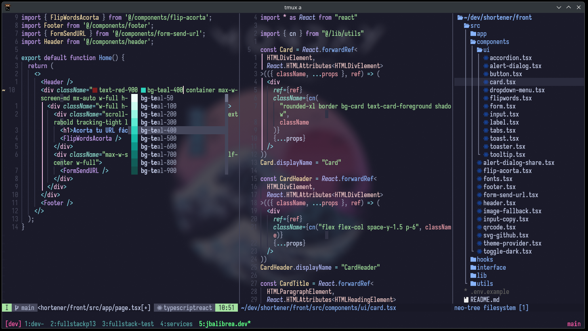

En este post, vamos a explorar sintaxis básica de Markdown y algunos ejemplos de resaltado de sintaxis.
En [jbalibrea.dev](https://jbalibrea.dev) el resaltado de sintaxis se renderiza gracias a [shiki](https://shiki.style/).

## Encabezados

Para crear encabezados, agrega el signo numeral de `#` delante de una palabra o frase. El número de signos de numeral corresponde al nivel del encabezado.

### Sintaxis

```
# Encabezado 1
## Encabezado 2
### Encabezado 3
#### Encabezado 4
##### Encabezado 5
###### Encabezado 6
```

### Resultado

# Encabezado 1

## Encabezado 2

### Encabezado 3

#### Encabezado 4

##### Encabezado 5

###### Encabezado 6

## Texto en Negrita, Cursiva y Tachado

### Sintaxis

```
**texto en negrita**, _texto en cursiva_, ~~texto tachado~~ `texto código` **_texto cursiva en negrita_** ~~_texto cursiva tachado_~~
```

### Resultado

**texto en negrita**, _texto en cursiva_, ~~texto tachado~~ `texto código` **_texto cursiva en negrita_** ~~_texto cursiva tachado_~~

## Párrafos

Para crear párrafos, separa las líneas de texto con una línea en blanco.

### Sintaxis

```
Lorem ipsum dolor sit amet, consectetur adipiscing elit. Nulla maximus egestas interdum. Nam volutpat tristique ullamcorper. Cras blandit vulputate enim vel ultrices. Curabitur quis elementum odio. In rhoncus fringilla facilisis. Phasellus semper leo ac nibh fermentum, eu tristique quam hendrerit.

Duis pharetra mi vel velit sodales, a tincidunt mauris eleifend. Suspendisse gravida risus nec velit interdum, id rhoncus libero venenatis.
```

### Resultado

Lorem ipsum dolor sit amet, consectetur adipiscing elit. Nulla maximus egestas interdum. Nam volutpat tristique ullamcorper. Cras blandit vulputate enim vel ultrices. Curabitur quis elementum odio. In rhoncus fringilla facilisis. Phasellus semper leo ac nibh fermentum, eu tristique quam hendrerit.

Duis pharetra mi vel velit sodales, a tincidunt mauris eleifend. Suspendisse gravida risus nec velit interdum, id rhoncus libero venenatis.

## Imágenes y enlaces

Para agregar una imagen, añade un signo de exclamación `!`, seguido de texto alternativo entre corchetes `[]`, y la ruta o URL de la imagen entre paréntesis `()`.
Para agregar un enlace es igual pero sin añadir la exclamación.

### Sintaxis

```


[enlace a URL](https://jbalibrea.dev/img/dotfiles/nvim1.png)
```

### Resultado


[enlace a URL](https://jbalibrea.dev/img/dotfiles/nvim1.png)

## Citas en Bloque

Para destacar citas, crea una cita en bloque, agregando un `>` delante de un párrafo. En citas con múltiples párrafos, añade `>` también antes de los espacios entre párrafos. Cuando necesites atribuir la fuente `<cite>nombre del autor</cite>` o `<footer>nombre del autor</footer>` para referencias bibliográficas, mientras que las notas al pie pueden insertarse usando la sintaxis con número `[^1]` o `[^note]`. Las notas se muestran con `[^1]: Texto explicativo` al final del documento.

### Cita en bloque con múltiples párrafos

#### Sintaxis

```markdown
> Morbi in lorem pellentesque, cursus orci vitae, egestas quam. Phasellus.
>
> **Fíjate** que se puede usar `sintaxis Markdown` dentro de una cita en bloque.
```

#### Resultado

> Morbi in lorem pellentesque, cursus orci vitae, egestas quam. Phasellus.
>
> **Fíjate** que se puede usar `sintaxis Markdown` dentro de una cita en bloque.

### Cita en bloque con fuentes citadas

#### Sintaxis

```markdown
> Simplicity is the ultimate sophistication.
>
> — <cite>Steve Jobs[^1]</cite>

[^1]: Esta frase apareció como titular en el primer folleto publicitario de Apple, publicado en 1977: [Apple II Marketing Brochure (PDF)](https://s3data.computerhistory.org/brochures/apple.ii.1977.102637933.pdf)

> [!NOTE]
> Según Steve Jobs, lograr la simplicidad requiere mucho trabajo duro para entender los desafíos subyacentes y encontrar soluciones elegantes. No es solo minimalismo o ausencia de desorden, sino profundizar en la complejidad para eliminar lo que no es esencial.
```

#### Resultado

> Simplicity is the ultimate sophistication.
>
> — <cite>Steve Jobs[^1]</cite>

[^1]: Esta frase apareció como titular en el primer folleto publicitario de Apple, publicado en 1977: [Apple II Marketing Brochure (PDF)](https://s3data.computerhistory.org/brochures/apple.ii.1977.102637933.pdf)

> [!NOTE]
> Según Steve Jobs, lograr la simplicidad requiere mucho trabajo duro para entender los desafíos subyacentes y encontrar soluciones elegantes. No es solo minimalismo o ausencia de desorden, sino profundizar en la complejidad para eliminar lo que no es esencial.

## Tablas

Crea tablas organizadas usando barras verticales `|` para separar columnas y guiones `---` para definir los encabezados. Cada fila debe comenzar y terminar con `|`.

### Sintaxis

```markdown
| Cursiva     | Negrita     | Tachado     | Código    |
| ----------- | ----------- | ----------- | --------- |
| _ejemplo 1_ | **texto 1** | ~~error 1~~ | `console` |
| _ejemplo 2_ | **texto 2** | ~~error 2~~ | `log()`   |
```

Resultado:

| Cursiva     | Negrita     | Tachado     | Código    |
| ----------- | ----------- | ----------- | --------- |
| _ejemplo 1_ | **texto 1** | ~~error 1~~ | `console` |
| _ejemplo 2_ | **texto 2** | ~~error 2~~ | `log()`   |

## Bloques de Código

Para crear bloques de código, agrega tres "backticks" ` ``` ` al inicio y al final de tu código. Puedes indicar el lenguaje de programación después
de la primera línea de "backticks" para resaltar la sintaxis, por ejemplo: `js`, `html`, `css`, `markdown`, etc. Esto permite que el código se muestre con resaltado de sintaxis y formato adecuado.

### Sintaxis

````
```js
function fib(n) {
  if (n <= 1) return n;
  const res = fib(n - 1) + fib(n - 2); // [!code --]
  return fib(n - 1) + fib(n - 2); // [!code ++]
}

fib(10); // [!code --]
// print first 10 Fibonacci numbers
\// [!code ++:4] <-- remove \
const n = 10;
for (let i = 0; i < n; i++) {
  console.log(fib(i)); // [!code highlight]
}
```
````

> [!NOTE]
> He añadido una barra invertida (\\) delante del comentario [!code ++\:4] solo en este ejemplo, para que Shiki no lo interprete y el texto se vea tal cual. No la incluyas en tu código.

### Resultado

```js
function fib(n) {
  if (n <= 1) return n;
  const res = fib(n - 1) + fib(n - 2); // [!code --]
  return fib(n - 1) + fib(n - 2); // [!code ++]
}

fib(10); // [!code --]
// print first 10 Fibonacci numbers
// [!code ++:4]
const n = 10;
for (let i = 0; i < n; i++) {
  console.log(fib(i)); // [!code highlight]
}
```

_La sintaxis resaltada en este caso es gracias a shiki, que permite resaltar la sintaxis de manera efectiva en los bloques de código._

## Tipos de Listas

### Lista de Tareas

#### Sintaxis

```markdown
- [x] HTML
- [x] JavaScript
- [x] Astro
- [ ] Rust
```

#### Resultado

- [x] HTML
- [x] JavaScript
- [x] Astro
- [ ] Rust

### Lista Ordenada

#### Sintaxis

```markdown
1. Primer elemento
2. Segundo elemento
3. Tercer elemento
```

#### Resultado

1. Primer elemento
2. Segundo elemento
3. Tercer elemento

### Lista No Ordenada

#### Sintaxis

```markdown
- Pasaporte
- Ordenador portátil
- Cargador de móvil
```

#### Resultado

- Pasaporte
- Ordenador portátil
- Cargador de móvil

### Lista Anidada

#### Sintaxis

```markdown
- Lenguajes de Programación
  - JavaScript
  - Go
  - Python
- Bases de Datos
  - MongoDB
  - PostgreSQL
```

#### Resultado

- Lenguajes de Programación
  - JavaScript
  - Go
  - Python
- Bases de Datos
  - MongoDB
  - PostgreSQL

> [!TIP]
>
> Si necesitas usar símbolos como _\# \_ \*_ y no quieres que tengan efecto puedes hacer que "escapen" mediante la barra
> invertida `\# \_ \*`

```markdown
\#No soy un encabezado, ni \*\*negrita\*\*, ni \_cursiva\_, tampoco \`código\`
```

\#No soy un encabezado, ni \*\*negrita\*\*, ni \_cursiva\_, tampoco \`código\`

## _Extra_, algunas etiquetas HTML gracias a @tailwindcss/typography tienen un estilo fantástico en estos tipos de blogs 🤓

Incluyendo superíndice `<sup>`, subíndice `<sub>`, abreviatura `<abbr>`, tachado `<del>`, subrayado ondulado `<u>`, entrada de teclado `<kbd>`, resaltado `<mark>` y línea horizontal `<hr>`.

### Sintaxis

```html
<p>
  <abbr title="Lenguaje de Marcado de Hipertexto">HTML</abbr> permite formatear
  texto de manera avanzada.
</p>

<p>H<sub>2</sub>SO<sub>4</sub> es la fórmula del ácido sulfúrico</p>
<p>E=mc<sup>2</sup> representa la famosa ecuación de Einstein</p>

Los atajos como <kbd>Cmd</kbd> + <kbd>C</kbd> y <kbd>Cmd</kbd>
<kbd>V</kbd> aceleran el trabajo y <kbd>CTRL</kbd> <kbd>ALT</kbd>
<kbd>SUPR</kbd> puede cerrar procesos. Recuerda la filosofía
<u title="Keep It Simple, Stupid">KISS</u>, a veces cuanto más
<del>complejo</del> simple mejor. Los elementos <mark>destacados</mark> ayudan a
enfatizar información importante. Para separar secciones, usa la etiqueta `
<hr />
` o tres guiones `---` para crear una línea horizontal como la siguiente:
```

### Resultado

<p>
  <abbr title="Lenguaje de Marcado de Hipertexto">HTML</abbr> permite formatear
  texto de manera avanzada.
</p>

<p>
  H<sub>2</sub>SO<sub>4</sub> es la fórmula del ácido sulfúrico
</p>
<p>
  E=mc<sup>2</sup> representa la famosa ecuación de Einstein
</p>

Los atajos como <kbd>Cmd</kbd> + <kbd>C</kbd> y <kbd>Cmd</kbd> <kbd>V</kbd> aceleran el
trabajo y <kbd>CTRL</kbd> <kbd>ALT</kbd> <kbd>SUPR</kbd> puede cerrar procesos.
Recuerda la filosofía <u title="Keep It Simple, Stupid">KISS</u>, a
veces cuanto más <del>complejo</del> simple mejor. Los elementos <mark>destacados</mark>
ayudan a enfatizar información importante. Para separar
secciones, usa la etiqueta `<hr />` o tres guiones `---` para crear una línea
horizontal como la siguiente:

---
